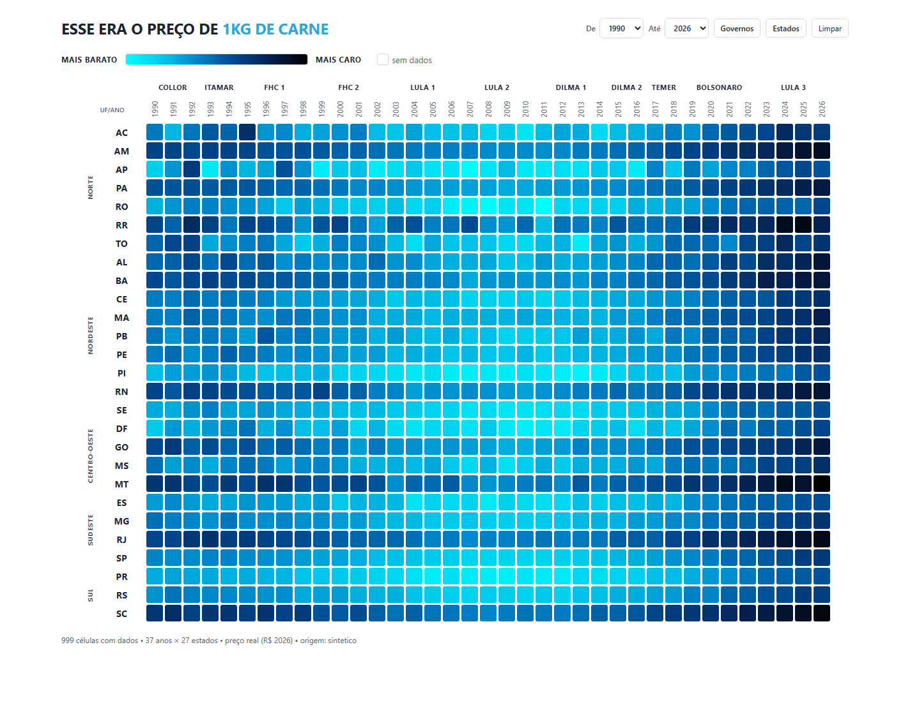

# ESSE ERA O PREÇO

**A memória aberta dos preços do Brasil.**

[](LICENSE)
[](#status)

Plataforma **open source e colaborativa** para construir um histórico público
de preços a partir de notas fiscais do consumidor (NFC-e).



*Dados sintéticos de demonstração.*

## Status

> MVP em desenvolvimento. Os dados exibidos hoje são **sintéticos**, gerados
> para desenvolver e testar o pipeline. O envio de notas reais ainda não está
> disponível.

## O que é

O projeto **ESSE ERA O PREÇO** vai reunir, de forma aberta e colaborativa, os
preços de produtos vendidos em mercados brasileiros. A ideia é responder perguntas como:

- Quanto custava o quilo da carne em 2010?
- Como o preço varia entre estados e regiões?
- Qual mercado está mais barato hoje?

O projeto começa pela **carne bovina**, mas a estrutura já foi pensada para
receber outros produtos e categorias.

## O problema

Preço de supermercado é uma informação pública na nota fiscal, mas continua
difícil de acessar de forma histórica, comparável e aberta. Cada compra gera um
XML da NFC-e com itens, quantidades e valores — mas esses dados ficam espalhados
em portais estaduais e não viram uma série histórica pública.

## Como vai funcionar

O envio de notas reais ainda é roadmap. O fluxo planejado é:

1. A pessoa envia uma **foto da nota** pelo site ou pelo WhatsApp.
2. O robô identifica o **QR code/chave de acesso**.
3. O sistema importa o **XML da NFC-e** da SEFAZ.
4. Extraímos itens, quantidades, preços, mercado, cidade e data.
5. Normalizamos produtos e estabelecimentos e removemos dados pessoais.
6. Deduplicamos pela chave da nota.
7. Os preços agregados aparecem no painel público.

## O que já existe

- Gerador sintético de NFC-e (1980–2026) para desenvolvimento e testes.
- Builder que lê XML, deduplica pela chave e gera o bundle de dados.
- Compilador que gera os dados enxutos consumidos pelo frontend.
- Heatmap **estado × ano** com medianas por estado/ano e por governo, popup,
  histograma e notas de exemplo.
- Streamgraph **UF × ano** em `/02/`, com mediana, mínimo e máximo por ano,
  destaque no hover e barras da mediana nacional.
- Deploy estático configurado para a Vercel.

## Roadmap

- [ ] Portal para envio de notas pelo site.
- [ ] Integração com WhatsApp.
- [ ] Robô de leitura do QR code e importação do XML da SEFAZ.
- [ ] Validação e moderação das notas enviadas.
- [ ] Novos produtos além da carne.
- [ ] API pública de preços.
- [ ] Política de dados abertos e licença dos dados.

## Privacidade e LGPD

- Não publicamos CPF/CNPJ do consumidor, endereço, forma de pagamento nem o XML
  bruto.
- A foto enviada é usada apenas para leitura e não é publicada.
- A chave de acesso é usada para deduplicação e para o link de consulta na
  SEFAZ.
- Os dados publicados são agregados; o foco é preço, produto, estabelecimento e
  localidade.
- O envio de notas reais só será aberto com uma política de privacidade e uma
  licença de dados definidas.

## Open source

O código é aberto e contribuições são bem-vindas. Você pode ajudar com:

- bugs e melhorias no frontend;
- novos produtos e categorias;
- importação e validação de NFC-e;
- documentação e testes;
- ideias para a visualização dos dados.

Leia [CONTRIBUTING.md](CONTRIBUTING.md) para começar. Para dúvidas e propostas,
abra uma issue.

## Rodando localmente

Requisitos: Node.js **>= 22.5**. O projeto não tem dependências externas.

```bash
npm run front      # serve web/ em http://localhost:8080/ (heatmap) e /02/ (streamgraph)
npm run verificar  # checagem usada no deploy
```

Para regenerar os dados:

```bash
npm run gerar      # XMLs sintéticos em data/xml
npm run build      # bundle completo em bundle/
npm run compilar   # dados enxutos em web/dados/
npm run pipeline   # os três
```

> `web/dados/` é versionado e usado no deploy. Cada `npm run compilar` sorteia
> novas notas de exemplo e altera esses arquivos. `data/` e `bundle/` não são
> versionados.

## Estrutura

```text
src/       pipeline de geração, build e compilação
web/       frontend estático publicado na Vercel
docs/      documentação técnica
scripts/   verificação de deploy
bundle/    bundle completo (gerado, não versionado)
data/      XMLs e SQLite (gerados, não versionados)
```

## Documentação

- [Arquitetura](docs/ARQUITETURA.md) — pipeline, SQLite, moedas e inflação.
- [Dados](docs/DADOS.md) — bundle, `web/dados`, amostragem e tamanhos.
- [Deploy](docs/DEPLOY.md) — servidor local, Vercel e gzip.
- [Contribuindo](CONTRIBUTING.md).

## Licença

Código sob [MIT](LICENSE). A licença dos dados será definida antes da abertura
do envio de notas reais.
